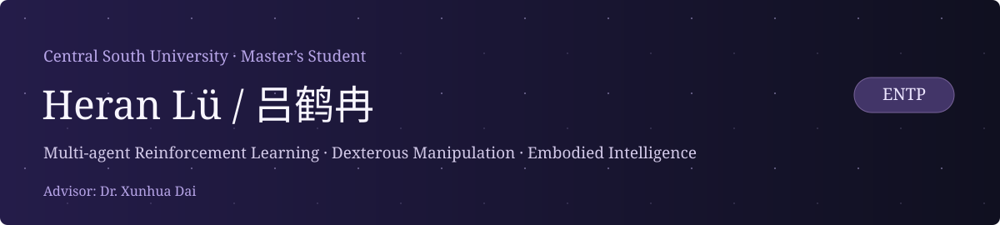
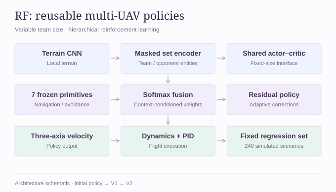
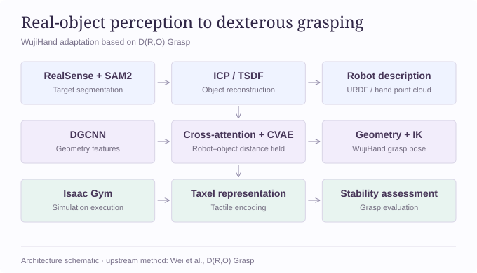
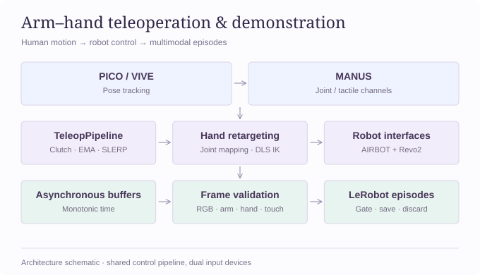
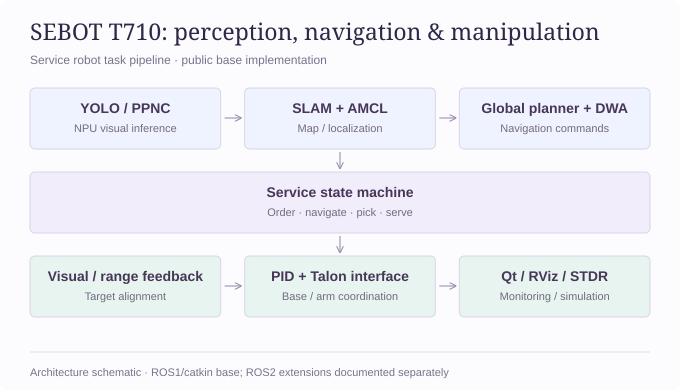

<a href="https://wild-pointer-04.github.io/">学术主页 / Academic Homepage</a> · <a href="https://faculty.csu.edu.cn/daixunhua/zh_CN/index.htm">导师 / Advisor</a> · <b>ENTP</b>

## 关于我 / About Me

我是 **吕鹤冉**，目前是 **[中南大学]** 的硕士研究生，导师是 **[戴训华博士](https://faculty.csu.edu.cn/daixunhua/zh_CN/index.htm)**。

我的研究兴趣集中在 **多智能体强化学习与具身智能**，研究与工程实践围绕以下方向展开：

- **多智能体学习与协同决策**：集合观测编码、共享策略、分层决策与课程训练。
- **灵巧操作与抓取表征**：真实物体点云、Robot–Object 几何表征与触觉稳定性评估。
- **机器人示教与系统实践**：臂手遥操、多模态示教采集和视觉闭环控制。

I am a master’s student at **Central South University**, advised by **Dr. Xunhua Dai**. My research focuses on multi-agent reinforcement learning, reusable policies, and embodied intelligence.

## 教育经历 / Education

- **中南大学（Central South University）** · 2026—2029（预计毕业）

  电子信息，硕士研究生，在读；导师：[戴训华博士](https://faculty.csu.edu.cn/daixunhua/zh_CN/index.htm)。
- **兰州理工大学（Lanzhou University of Technology）** · 2022—2026

   软件工程，本科；专业排名：**1/215**。

## 研究项目 / Research Projects

### 1. RF｜基于强化学习学习与策略融合的多无人机攻防对抗自进化系统

**个人研究项目 ·面向可变团队规模的多无人机分层强化学习与策略复用**

面向复杂障碍环境下的无人机自主导航与攻防对抗，构建支持 1v1 至 10v10 的强化学习训练与评测系统，研究基础策略复用、多机交互决策及训练部署一致性问题。独立负责环境开发、网络设计、训练迭代与实验评测。

- 策略网络： 设计融合 CNN 地形编码与 MaskedSetEncoder 集合编码的 Actor-Critic 网络，联合处理自身状态、航路点和敌友态势；复用导航、避障与进攻策略，通过 Softmax 策略融合 + 动作残差学习生成三轴速度指令，实现基础技能与场景决策的组合。
- 课程与迁移学习： 构建导航、静态避障、对抗、多机交互及复杂地形的 五阶段课程，通过预训练参数迁移、模块冻结与逐阶段优化复用已有能力；分别训练进攻与防御策略，并实现高层目标分配、航路引导与底层机动控制的分层协作。
- 多机强化学习： 实现共享场景下的多机 PPO，针对飞机淘汰、回合终止及无效槽位，设计存活与终止掩码、掩码 GAE 和有效样本筛选，避免无效交互及终止后的价值估计污染策略更新。
- 仿真与实验工程： 将无人机动力学与串级 PID 控制流程迁移为 PyTorch 批量张量计算，支持 GPU 并行采样；建立场景配置、模型版本与评测结果可追溯的实验流程，记录任务成功、障碍碰撞、机间碰撞及被拦截等指标

技术细节与版本说明

版本演进：初始融合策略 stage5  → V1（地形与避障课程、全网络适配）→ V2（基础模块冻结、多机共享策略训练）。

(https://github.com/wild-pointer-04/RF-LSTM) · [学术主页中的项目详情](https://wild-pointer-04.github.io/#rf)

PyTorch · PPO · Masked Set Encoding · Policy Sharing · Skill Reuse

---

### 2. 实物点云驱动的 WujiHand 跨本体抓取与触觉评估

**多自由度灵巧手 · 多种物体 · 可泛化可迁移抓取**

基于 D(R,O) Grasp 距离场表征框架，连接真实物体点云提取、Robot–Object 双边网络、WujiHand 姿态恢复与触觉稳定性评估。

- 抓取表征与求解：DGCNN 提取手部/物体点云特征，Cross-attention 建立几何关联，CVAE 建模多模态抓取；经 Multilateration、SE(3) 恢复与可微 IK 求解 WujiHand 姿态。
- 实物点云管线：RealSense + ROS 2 + SAM2 完成采集与目标分割，结合 Colored ICP/TSDF、RGB-D VO、DBSCAN 与 RANSAC 组织配准、重建及点云清理。
- 仿真与触觉评估：在 Isaac Gym 中完成 URDF、IK 对齐与 PD 抓取控制；构建五指 Taxel 阵列、CAE 触觉编码和双特征表征，用于抓取稳定性判断。

结果与实现：形成“实物点云 → 跨本体抓取姿态 → 仿真执行 → 触觉稳定性评估”的研究链路。

技术细节与版本说明

WujiHand 抓取配置包含 6 维全局位姿与 20 个手指关节，共 26 个配置自由度。补充构型不变性预训练、合成抓取数据与配对点云数据集，连接模型训练、抓取执行和仿真验证。

[代码 / Code](https://github.com/wild-pointer-04/DRO_wujihand) · [学术主页中的项目详情](https://wild-pointer-04.github.io/#grasp)

PyTorch · DGCNN · Cross-attention · CVAE · Open3D · Isaac Gym

---

### 3. 臂手协同遥操作与多模态示教采集

**项目 Owner 与核心开发者，面向科研预研与机器人示教需求，主导整体方案设计、核心模块开发与软硬件集成，推动系统从 PICO／MANUS 双链路遥操向 VIVE 接入、统一控制采集架构迭代**

面向机器人遥操与示教，构建 AIRBOT 机械臂、Revo2 灵巧手与 MANUS 数据手套协同系统，贯通设备输入、动作重定向、末端控制与数据采集。

- 统一控制管线：将 VIVE 双Tracker 和 SteamVR/OpenVR 输入转换为统一位姿协议，复用 TeleopPipeline；结合 Clutch、EMA、SLERP 与工作空间约束生成末端目标。
- 手部重定向：人体关节语义映射生成 Revo2 六维动作；四指加权屈曲、拇指屈曲/外展分通道，并集成向量映射与 DLS 拇指 IK 可选后端。
- 多模态示教：ROS 2/rosbridge + LeRobot 组织 RGB、臂关节/末端、手部状态与五指触觉；单调时钟和异步缓存支持帧校验、脚踏门控、Episode 切分与续采。

结果与实现：实现 PICO/VIVE 双输入适配、Revo2 六维动作重定向与多模态 Episode 采集，形成可复用的臂手协同工程原型。

技术细节与版本说明

从 PICO + MANUS 双链路原型迭代到 VIVE 输入适配、统一控制管线与 LeRobot 采集。完成坐标基变换、身体相对位姿映射、安装外参与真机跟随调试，并接入五指法向力到 MANUS 振动反馈的映射。

[代码 / Code](https://github.com/wild-pointer-04/airbot-revo-workspace) · [学术主页中的项目详情](https://wild-pointer-04.github.io/#teleop)

Python · ROS 2 · OpenVR · Hand Retargeting · DLS IK · LeRobot

---

### 4. SEBOT T710｜自主导航与视觉闭环操作

**本科机器人项目 · 感知、规划与控制**

面向专业餐饮服务场景，将端侧目标检测、激光建图、定位导航、视觉伺服抓取与任务状态机整合到 T710 机器人平台。

- 端侧视觉：PaddleDetection/YOLO 与 PPNC/NPU 推理，结合 ONNX Runtime 后处理及 NMS，将检测结果输入导航与抓取任务。
- 导航与任务编排：SLAM、AMCL/EKF、代价地图与全局/局部规划贯通移动导航；服务状态机衔接点餐、取放、送餐及结算。
- 视觉闭环操作：通过视觉偏差与雷达距离反馈，协调底盘接近、目标对准、PID 调节和 Talon 机械臂动作；配套 Qt/RViz 与 STDR 联调。

结果与实现：贯通“目标检测 → 建图定位 → 导航到达 → 视觉抓取 → 服务执行”的系统链路。

技术细节与版本说明

公开基础版本为 ROS1/catkin，默认 Dijkstra + DWA，并包含 A*。项目扩展包括 YOLO 训练/剪枝、Docker 部署，以及 ROS2 下改进 A* + TEB 与强化学习抓取；扩展实现范围见仓库说明。

[代码 / Code](https://github.com/wild-pointer-04/sebot-t710-competition) · [学术主页中的项目详情](https://wild-pointer-04.github.io/#sebot) · [公开实现范围](https://github.com/wild-pointer-04/sebot-t710-competition/blob/main/docs/IMPLEMENTATION_STATUS.md)

C++ · ROS · YOLO · SLAM · Visual Servoing · OpenCV

---

Research in multi-agent learning, dexterous manipulation, and embodied intelligence.
